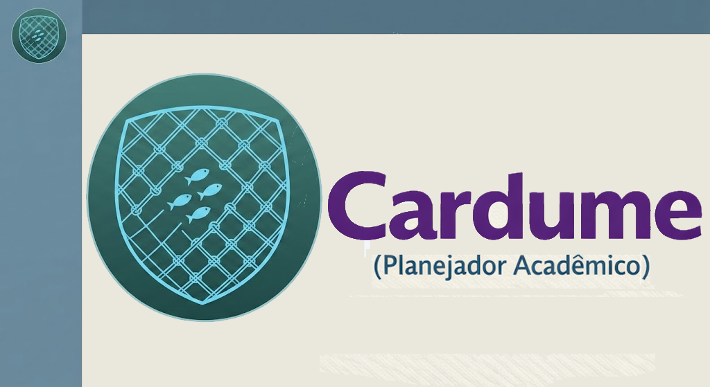

# Cardume - Planejador Academico | IECOS/UFPA



Sistema web para montar, revisar e publicar a oferta de componentes das turmas
do IECOS/UFPA (Campus Braganca). Os coordenadores alocam cada componente por
datas e horarios, o Cardume confere os choques de turma e de professor, e o
administrador publica a agenda que alunos e docentes consultam no celular.

Desde 05/11/2026 o app roda no servidor da UFPA (PHP + MariaDB), com os dados
compartilhados entre as coordenacoes.

| | Endereco |
|---|---|
| App | `https://cardume.iecos.ufpa.br/` |
| Agenda publica | `https://cardume.iecos.ufpa.br/agenda_publica.html` |
| Endereco antigo (GitHub Pages) | mostra o aviso de mudanca (`mudou.html`) |

Documentacao tecnica:
[`docs/manual_desenvolvedor.md`](docs/manual_desenvolvedor.md) ·
[`docs/plano_refatoracao.md`](docs/plano_refatoracao.md) ·
[`docs/plano_banco_dados_e_cadastro.md`](docs/plano_banco_dados_e_cadastro.md)

O guia de uso para os coordenadores fica dentro do app, na aba **Ajuda**
(temas Comecar, Alocacao, Revisao, Docentes, Publicacao e Arquivos).

---

## Funcionalidades

**Alocar Componentes** (centro do trabalho)
- Escolha de periodo letivo, curso, turma e turno na barra lateral; componente
  buscada pelo nome, com `codigo · curso` e a CH do curso da turma.
- Ate 3 **faixas** por componente (horario semanal num intervalo de datas). A
  faixa nova nasce sozinha ao redesenhar numa semana posterior, com **Desfazer**.
- **Pausa e intercalacao**: um Fim digitado antes do Inicio da faixa seguinte
  deixa os dias do meio sem aula, livres para outra componente da turma.
  Componente com pausa nunca e empurrada sozinha (choque bloqueia o salvar).
- Feriados na grade (coluna listrada com o nome), sabado no turno da manha,
  aviso de turno diferente, varios docentes com CH parcial, cadastro de
  docente novo, cores escolhidas numa paleta (tom suave na grade semanal;
  cor forte nos calendarios e na agenda publica).
- Cartao **Proximo passo** no topo da aba: diz o que falta e mostra os avisos.

**Revisao**
- **Lista de Ofertas**: editar, excluir, **Trocar** duas componentes de lugar,
  selo **faltam Xh**, exportacao de metadados SIGAA.
- **Calendario da Turma**: mes a mes, com a tabela de CH alocada.
- **Choques**: na turma (ao salvar) e de professor (alerta global, inclusive
  com outro PL que corre nas mesmas datas).

**Docentes**
- **Calendario Docente**: ano inteiro (PL1 a PL4) ou um PL; tabela com o nome
  do professor, horario de cada faixa, CH docente (`30/90` quando dividida),
  CH alocada (verde/vermelha) e conflitos, inclusive entre PLs.

**Publicacao e administracao**
- **Publicar Online** (so o administrador): grava a agenda no servidor; entram
  o periodo em curso e ate 4 futuros com alocacoes.
- Menu **Agenda Publica**: a agenda publicada num celular grande, dentro do app.
- **Usuarios e backup** (administrador): acessos, senha provisoria, docentes
  novos para conferir e copia `.sql` do banco.

---

## Modelo canonico

**Faixa** = regime de funcionamento num intervalo de datas.

- a faixa nova substitui a anterior a partir do seu Inicio; o Fim da anterior
  vira a vespera, **exceto** quando o Fim foi digitado antes disso (pausa);
- os horarios de cada faixa so existem se forem desenhados;
- CH, conflitos, calendarios, agenda e exportacoes partem da execucao real
  gerada pelas faixas (`js/execution_engine.js`, `js/faixa_utils.js`);
- a pausa nao muda o formato salvo: e so a data sem faixa vigente
  (`js/pausa_faixas.mjs`, testada em `tests/pausa_faixas.test.mjs`).

**Conflito** so existe quando ha, ao mesmo tempo, sobreposicao de periodo, de
dia da semana e de horario:

`conflito = overlap(periodo) AND overlap(dia) AND overlap(slot)`

Uma componente nunca atravessa PLs (comeca e termina dentro do seu PL).

---

## Servidor da UFPA (modo `ufpa`, o padrao)

- Hospedagem CTIC: `cardume.iecos.ufpa.br` (PHP 8.2 + MariaDB 11.8). FTP e
  painel so com a VPN da UFPA; o phpMyAdmin abre sem VPN.
- Banco: `mysql/schema.sql`. API: `api/index.php`. A senha do banco fica em
  `api/config.php` (copiar de `api/config.exemplo.php`; fora do Git e bloqueado
  pelo `api/.htaccess`).
- Login, permissao por curso (cada coordenador altera so as turmas do seu
  curso; o admin altera todas; todos veem tudo), historico e ultimo acesso sao
  feitos pela API. Sem tempo real: o navegador consulta as mudancas a cada 5 s
  (30 s com a aba em segundo plano).
- `.htaccess` da raiz: tipo correto para os `.mjs`, cache sempre conferido,
  JSON compactado e pastas de trabalho (`tools/`, `mysql/`, `docs/`...) fora do
  ar. Se o site der erro 500 depois de envia-lo, apague esse arquivo.
- Firewall do servidor (ModSecurity): recusa envios maiores que 128 KB e corpos
  `application/json` com 1000 campos ou mais. Por isso `js/remoto_ufpa.js` manda
  o JSON como `text/plain`, divide o salvar em envios de ate 100 KB e manda a
  agenda em pedacos (`publicar_parte`).
- Agenda publica: **Publicar Online** grava em `agenda_publicada` (ficam as 30
  ultimas; desfazer = apagar a ultima linha) e `agenda_publica.html` le de
  `api/?acao=agenda`.

### Atualizar o site

```bash
npm test && npm run smoke          # tudo verde antes de enviar
python tools/montar_envio_ufpa.py  # monta ../cardume_envio_ufpa
```

No FileZilla (com a VPN), enviar o conteudo de `../cardume_envio_ufpa` para a
raiz `/`. A pasta nunca leva o `api/config.php`, que nao pode ser sobrescrito.

### Teste local igual ao servidor (Docker)

`tools/servidor_local/docker-compose.yml` (instrucoes no proprio arquivo);
abrir `http://localhost:8080/?backend=ufpa`. O banco local vem de um backup:
os dados podem estar atrasados em relacao ao site.

### Modos antigos

- `local` (`?backend=local`): dados so no `localStorage` do navegador, senha
  unica. Usado pelos testes automaticos.
- `supabase`: banco usado ate 05/11/2026, hoje so leitura. Codigo em
  `js/remoto_supabase.js` e `supabase/schema.sql`; a copia para o servidor da
  UFPA foi feita com `tools/migracao_supabase_ufpa.py`.
- `tools/publish_online.py` publicava a agenda no GitHub Pages (modos `local`
  e `supabase`); no modo `ufpa` basta o botao **Publicar Online**.

---

## Dados e manutencao

`dados_app.json` e gerado a partir de `dados/planilha_base.xlsx`:

```bash
python tools/convert_data.py
```

Abas esperadas: `docentes`, `componentes`, `turmas`, `cursos`, `horarios`,
`feriados`, `periodos_letivos`.

- `periodos_letivos` e a fonte oficial dos periodos (ano, PL, inicio, fim). O
  seletor lateral e as datas dos planos vem dela.
- Nao altere as datas de um periodo que ja tem plano salvo: a chave do plano e
  `periodo + inicio + fim`, e o plano parece "sumir".
- Correcao de nome de docente: troque na coluna `docente` e ponha a grafia
  antiga em `nomes_anteriores` (separadas por `;`). Ao carregar, o app troca a
  grafia antiga pela nova nas alocacoes.
- `regime_vigencia` (em `tools/convert_data.py`, hoje `2026-08-24`): a partir de
  quando cada curso usa o seu quadro de horarios.
- Mudanca de quadro de um curso (coluna `regime` da aba `cursos`): as ofertas
  salvas passam ao quadro novo aula por aula (`js/quadro_horario.mjs`).
- O mesmo nome de componente pode existir em varios cursos com codigo e CH
  diferentes: as buscas usam sempre o curso da turma
  (`findComponente(nome, turmaId)` em `js/curso_turma_helpers.js`).

---

## Testes e versao dos arquivos

```bash
npm test                              # todas as suites de tests/ (Node 22+)
npm run smoke                         # abre o app num Chrome/Edge invisivel e passa pelas abas
node tools/teste_pausa_intercalada.mjs  # pausa + outra componente no meio, de ponta a ponta
node tools/prints_instrucoes.mjs      # refaz os prints de img/instrucoes (menu e Ajuda)
```

**Versao dos arquivos (cache):** todos os `.js`/`.css` sao chamados com o mesmo
`?v=CARIMBO`. Depois de mudar qualquer arquivo de `js/` ou `css/`, rode
`npm run versao`. O `npm test` confere se ficou tudo igual.

---

## Onde fica cada coisa

| Arquivo | O que faz |
|---|---|
| `index.html` | o app (barra lateral e abas) |
| `agenda_publica.html`, `js/agenda_publica.js` | a agenda publica |
| `js/main.js` | partida, exportar/importar, publicar |
| `js/ui.js` | aba Alocar Componentes e Lista de Ofertas (o maior arquivo; fatiamento em `docs/plano_refatoracao.md`) |
| `js/calendarios_ui.js`, `js/conflitos_ui.js` | Calendario da Turma/Docente e alerta global de choques |
| `js/execution_engine.js`, `js/faixa_utils.js`, `js/calendar.js` | motor das faixas e das aulas |
| `js/pausa_faixas.mjs`, `js/troca_ordem.mjs`, `js/pendentes.mjs` | regras puras, com testes |
| `js/sync_remoto.js`, `js/remoto_ufpa.js`, `api/index.php` | servidor |
| `js/admin_ui.js`, `js/acesso_ui.js` | login, barra de sincronizacao, Usuarios e backup |
| `js/ajuda_ui.js`, `css/ajuda.css` | aba Ajuda |
| `css/style.css`, `css/alocar-componentes.css` | estilos gerais e da aba Alocar |
| `js/color_utils.js`, `js/seletor_cor.js` | paleta das componentes e tons suaves da grade semanal |
